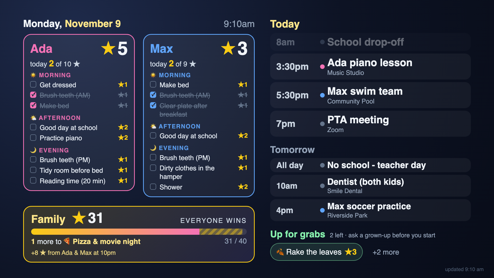

# family-dashboard

An always-on family dashboard for a **Roku TV** (or any browser): each kid's chores and
stars, a shared family reward pot, "up for grabs" jobs and today's calendar — pulled from
a [Skylight](https://www.skylightframe.com/) calendar and rendered as one full-screen image.



*(Sample data. Not affiliated with Skylight or Roku.)*

## How it works

```
Skylight API ──► familydash (Docker) ──► dashboard.jpg every minute ──► Roku app shows it
                  │  headless Chromium renders HTML → image
                  ├─ optional: TV on/off schedule + keep-alive (Roku ECP)
                  └─ optional: nightly "star sweep" (kids' stars → family pot)
```

Rendering on the server keeps the Roku side tiny (it just displays an image) and lets
the layout be ordinary HTML/CSS. A fit step running in the browser trims and resizes
content so a busy day never overflows the screen: up-for-grabs and tomorrow give way
first, today's calendar last, and chore text grows when there's spare room.

**Kids' cards** follow Skylight's routine windows (Morning / Afternoon / Evening); each
part of the day drops off once it's over, finished chores sink to the bottom.
**Family card** shows the family profile's stars and progress to its cheapest unreached
reward. **Meeting links** in event locations are never shown (they can contain passwords).

## Quick start

On an always-on machine on the same network as the TV (Docker required):

```sh
mkdir family-dashboard && cd family-dashboard
curl -fsSLO https://raw.githubusercontent.com/rosskukulinski/family-dashboard/main/deploy/docker-compose.yml
curl -fsSL  https://raw.githubusercontent.com/rosskukulinski/family-dashboard/main/deploy/.env.example -o .env
$EDITOR .env          # Skylight login + frame id, kid names, PUBLIC_URL, TV address
docker compose up -d
open http://localhost:8097/dashboard.png
```

Without Skylight credentials it renders `data/data.json` (same shape as
[`examples/sample.json`](examples/sample.json)) — handy for other data sources.

### Roku TV

1. Enable developer mode on the TV: on the remote press **Home ×3, Up ×2, Right, Left,
   Right, Left, Right**, accept, set a password. Put the TV's IP and that password in
   `.env` (`ROKU_TV_IP`, `ROKU_DEV_PASSWORD`).
2. Install the app (built with your `PUBLIC_URL`): `docker compose exec dashboard python -m familydash roku-install`
3. For the schedule: on the TV set **Settings → System → Advanced system settings →
   Control by mobile apps → Network access → Permissive**, **Power → Fast TV start → On**
   and **Auto power savings → Off**.
4. If the TV is on a separate VLAN, allow it to reach `PUBLIC_URL`'s port (TCP 8097).

### Keeping it updated

`deploy/update.sh` pulls the latest image, restarts only if it changed, and re-installs
the Roku app when its version changed. Run it every 15 minutes (cron, systemd timer, or
the included macOS launchd job `deploy/com.familydash.update.plist`).

## Configuration

All settings are environment variables — see [`deploy/.env.example`](deploy/.env.example).

| Variable | Default | |
|---|---|---|
| `SKYLIGHT_EMAIL` / `SKYLIGHT_PASSWORD` / `SKYLIGHT_FRAME_ID` | – | Skylight account and frame |
| `KIDS` | – | `Name:#colour,Name` — Skylight profile names, display order |
| `FAMILY_PROFILE` | `family` | profile holding shared stars |
| `TZ` | `UTC` | your time zone |
| `PUBLIC_URL` | – | how the TV reaches this server, e.g. `http://192.168.1.10:8097` |
| `ROKU_TV_IP` / `ROKU_DEV_PASSWORD` | – | enables TV schedule + `roku-install` |
| `TV_ON_AT` / `TV_OFF_AT` | `07:00` / `20:00` | daily on, evening off (never interrupts playing shows or HDMI inputs) |
| `STAR_SWEEP` / `STAR_SWEEP_AT` | `off` / `22:00` | nightly move of every kid's stars into the family profile (**writes to Skylight**) |
| `GRABS_NOTE` | `ask a grown-up before you start` | text under "Up for grabs" |

## Development

```sh
python -m venv .venv && . .venv/bin/activate
pip install -e '.[dev]' && python -m playwright install chromium
pytest                      # unit + browser layout tests
ruff check .
KIDS=Ada,Max TZ=America/Los_Angeles python -m familydash render-once examples/sample.json out.png --at 2026-11-09T09:10:00-08:00
```

CI runs lint, unit tests, browser layout tests, a BrightScript compile check of the Roku
app and a multi-arch image build; pushes to `main` publish
`ghcr.io/rosskukulinski/family-dashboard:latest`.

The Skylight client replays the same login and JSON endpoints Skylight's web app uses
(there is no public API), so it may break if Skylight changes them. Only reward points
are ever written, and only by the opt-in star sweep.

## License

MIT
